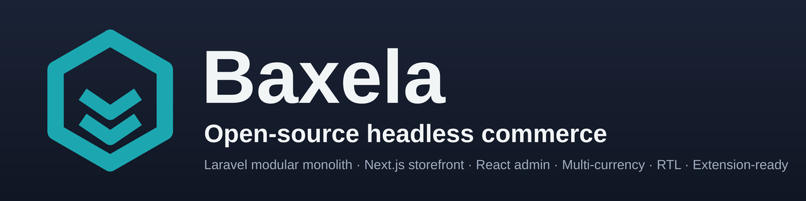

  

# Baxela

**Open-source, self-hostable headless commerce.** One Laravel backend, every storefront — built as a modular monolith with a real extension system and marketplace.

- 🧩 **Modular by design** — catalog, cart, checkout, payments, tax, shipping, promotions, inventory, invoices, notifications: each a module behind contracts, not spaghetti.
- 💱 **Multi-currency, snapshot-honest** — orders freeze their display currency and FX rate; invoices never drift from the order they were cut from.
- 🌍 **RTL first-class** — Arabic and Persian ship as real locales end-to-end (storefront, admin, emails, PDF invoices), not afterthoughts.
- 🔌 **Extensions like packages** — payment drivers are registry-driven; `composer require` an extension, `baxela:install` wires it. The composer marketplace handles ingestion, updates and yanks.
- 🛡 **Security taken seriously** — 2FA on admin access, sign-in lockout, session revocation, permission-gated admin, signed outbound webhooks, audit logs.

## The repos

| Repository | What it is |
|---|---|
| [`baxela`](https://github.com/baxela-hq/baxela) | The platform monorepo — Laravel 13 modular monolith, Next.js storefront, React admin |
| [`baxela-marketplace`](https://github.com/baxela-hq/baxela-marketplace) | The composer registry & marketplace — ingestion, catalog, update resolution, review flow |
| [`baxela-sandbox-gateway`](https://github.com/baxela-hq/baxela-sandbox-gateway) | Reference extension — a sample payment driver proving the extension system end-to-end |

## Status

> **Pre-alpha — under active development.** No stable release has been tagged yet; expect breaking changes between commits. The honest, item-by-item roadmap lives in [`docs/ROADMAP.md`](https://github.com/baxela-hq/baxela/blob/main/docs/ROADMAP.md), with deeper plans under `docs/plans/`.

## Community

- 💬 Questions, ideas and show-and-tell → [Discussions](https://github.com/baxela-hq/baxela/discussions)
- 🐛 Bugs and feature requests → [Issues](https://github.com/baxela-hq/baxela/issues)
- 🔒 **Security**: private vulnerability reporting is enabled — please use GitHub's *Report a vulnerability* instead of a public issue
- 📄 Licensed under [MIT](https://github.com/baxela-hq/baxela/blob/main/LICENSE)

---

  Built by <a href="https://github.com/baxela-hq">@baxela-hq</a> · Laravel · Next.js · React · TypeScript

